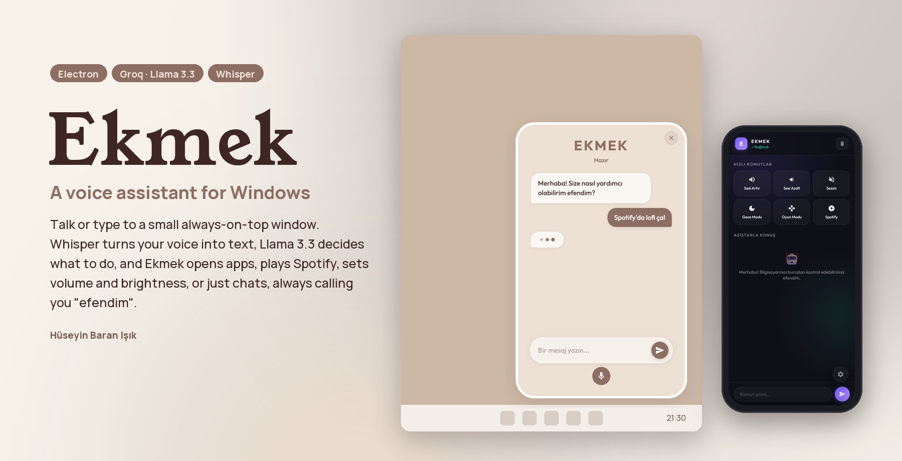
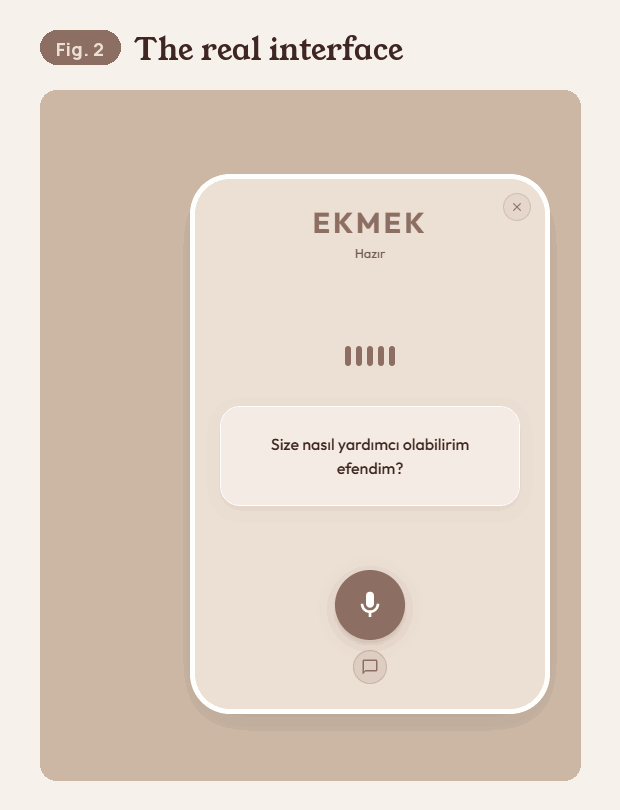
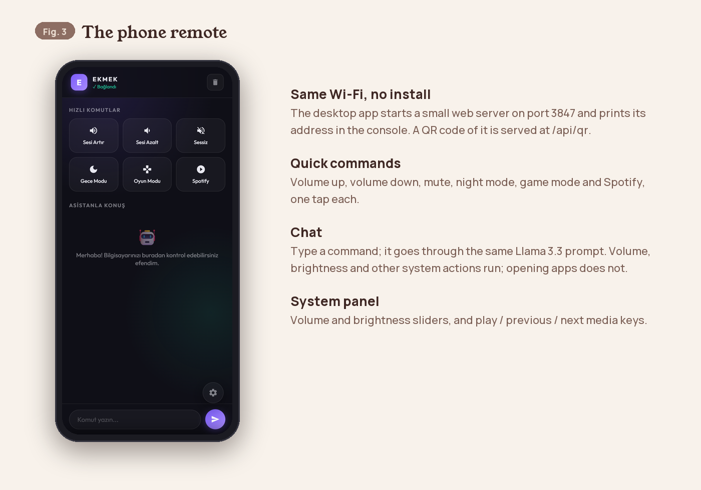
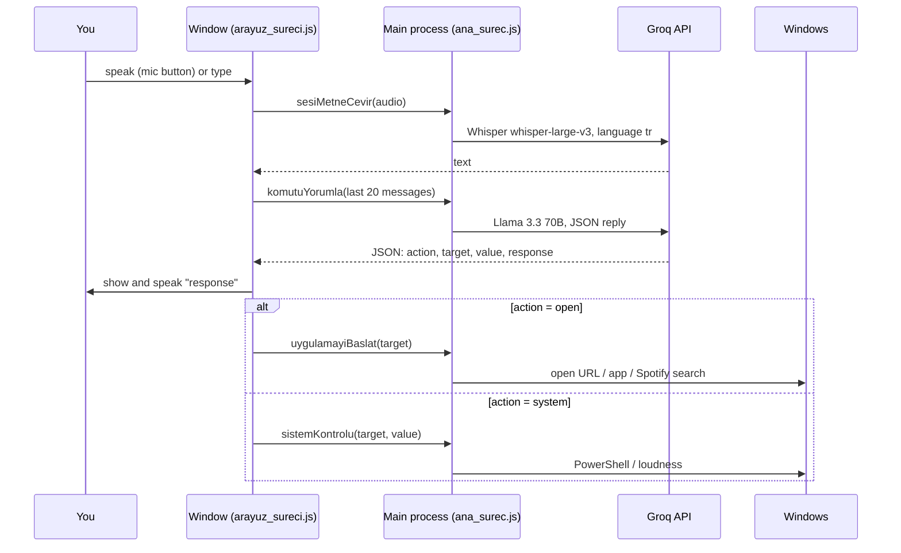

<p align="center">
  
</p>

<p align="center">
  <a href="#demo">Demo</a> &nbsp;·&nbsp;
  <a href="#what-it-does">What it does</a> &nbsp;·&nbsp;
  <a href="#how-it-works">How it works</a> &nbsp;·&nbsp;
  <a href="#run-it">Run it</a> &nbsp;·&nbsp;
  <a href="#known-limits">Limits</a> &nbsp;·&nbsp;
  <a href="#türkçe">Türkçe</a>
</p>

**Ekmek** ("bread" in Turkish) is a personal voice assistant for Windows. It lives in a small always-on-top window
in the corner of the screen and in the system tray. You speak or type in Turkish; Groq's Whisper turns speech
into text, Llama 3.3 decides what to do, and Ekmek opens apps and websites, plays music on Spotify, changes volume
and brightness, switches between game and night modes, or just chats. It always addresses you as *efendim*.
A phone on the same Wi-Fi can control it too.

<br>

## Demo

<p align="center">
  
</p>

This is the real `index.html` and `stiller.css`, recorded in Chromium (the engine Electron uses) by
[`tools/capture_ui.py`](tools/capture_ui.py) with a test microphone. Answers come from Groq and need an API key,
so in this recording the calls to Electron's main process are left without an answer: the chat stops at the
app's typing indicator instead of showing a reply that was not really generated.

<p align="center">
  
</p>

<br>

## What it does

<table>
<tr><td width="24%"><b>Voice and chat</b></td><td>Press the microphone to record and press again to stop; the audio goes to Whisper (<code>whisper-large-v3</code>, Turkish). Or switch to chat mode and type. Both share the last 20 messages as context. Replies are read aloud with the system's Turkish voice.</td></tr>
<tr><td><b>Opens things</b></td><td>Websites, programs by path, and a few known apps (Calculator, Notepad, Chrome, League of Legends, Instagram). Music requests become a Spotify search; "beğenilenler" opens your liked songs. After a few seconds Ekmek presses Enter and Play so the music starts.</td></tr>
<tr><td><b>System control</b></td><td>Volume, mute, screen brightness, keyboard backlight (Acer laptops), and media play / next / previous, through PowerShell and the <code>loudness</code> package.</td></tr>
<tr><td><b>Modes</b></td><td><b>Oyun</b> (game): volume 60, brightness and keyboard light 100, Spotify opens. <b>Gece</b> (night): volume 20, brightness and keyboard light 0. <b>Normal</b>: volume 50, brightness 60.</td></tr>
<tr><td><b>Lives in the tray</b></td><td>Closing the window hides it; the tray icon shows or hides it, toggles "always on top" and quits.</td></tr>
<tr><td><b>Phone remote</b></td><td>A web page served on port 3847: quick command buttons, a chat that uses the same prompt, and volume / brightness sliders with media keys.</td></tr>
</table>

<br>

## How it works

Electron's main process (`ana_surec.js`) owns the window, the tray and the remote-control server. The window's
script (`arayuz_sureci.js`) talks to it only through the small API in `on_yukleme.js`.



The model is told to always answer in JSON with an `action` (`open`, `system`, `mode` or `unknown`), a `target`,
a `value` and a `response` that contains "efendim". Modes are applied in `moduller/zeka.js`; the phone page posts
to `/api/komut` and `/api/sistem` on the same server (`moduller/uzak_kontrol.js`).

| File | Job |
| :--- | :--- |
| `ana_surec.js` | Window, tray, IPC handlers, starts the remote server |
| `arayuz_sureci.js`, `index.html`, `stiller.css` | The window: microphone mode, chat mode, speech output |
| `moduller/zeka.js` | Groq calls: Llama for commands, Whisper for speech; the three modes |
| `moduller/uygulama.js` | Opening apps, URLs and Spotify |
| `moduller/sistem.js` | Volume, brightness, keyboard light, media keys |
| `moduller/uzak_kontrol.js`, `uzak_arayuz/` | The phone remote (Express server and its page) |
| `veri/sozluk.json` | A Turkish word list (63 356 words) with add / edit / delete / search handlers |

<br>

## Run it

Windows, Node.js and a [Groq API key](https://console.groq.com/keys).

```bash
git clone https://github.com/huseyinbaranisik/EKMEK.git
cd EKMEK
npm install
```

Create a `.env` file next to `package.json`:

```
GROQ_API_KEY=your_key
# optional: SOHBET_MODELI=llama-3.3-70b-versatile, SES_MODELI=whisper-large-v3, UZAK_PORT=3847
```

```bash
npm start
```

`kisayol_olustur.ps1` puts an "Ekmek AI" shortcut on the desktop that runs `npm start`. For the phone remote,
open the address printed in the console (`http://<your PC's IP>:3847`) on a phone on the same Wi-Fi.

### The older Python version

`basla.py`, `cekirdek/`, `arayuz/` and the Python modules are an earlier prototype: it waits for the wake word
"ekmek", works offline with a local Ollama model when there is no internet, checks spelling against TDK, and has a
coding helper that searches Stack Overflow and GitHub. It runs with `pip install -r gereksinimler.txt` and
`python basla.py`, plus `numpy` and `sounddevice`, which `gereksinimler.txt` does not list yet.

<br>

## Known limits

> [!WARNING]
> **The phone remote has no password.** The server listens on all network interfaces (`0.0.0.0:3847`), so anyone
> on the same network can change the volume and brightness or send chat commands. Use it only on a network you
> trust.

- **Model output reaches the shell.** Apps are opened with `start <target>` built from the model's reply, so a
  crafted request could make it run an unintended command.
- **Keyboard backlight works only on Acer laptops** (it calls Acer's `AcerGamingFunction` WMI class).
- **Some features are wired on one side only.** The server sends remote chats to the desktop window and serves a
  QR code at `/api/qr`, but the window does not show either yet. The word list has back-end handlers but no screen.
- **Windows only**: `start`, PowerShell and WMI are Windows features.

<br>

## Credits

- By Hüseyin Baran Işık, under the MIT License ([`LICENSE`](LICENSE)).
- Speech and language models: Whisper and Llama 3.3 through the [Groq](https://groq.com) API.
- README figures set in Young Serif and Manrope, both under the SIL Open Font License ([`tools/fonts/`](tools/fonts/)),
  in the app's own colours. Rendered by [`tools/render_figures.py`](tools/render_figures.py).

<br>

---

## Türkçe

**Ekmek**, Windows için kişisel bir sesli asistandır. Ekranın köşesinde her zaman üstte duran küçük bir pencerede ve
sistem tepsisinde yaşar. Türkçe konuşur ya da yazarsın; Groq'un Whisper modeli sesi metne çevirir, Llama 3.3 ne
yapılacağına karar verir ve Ekmek uygulama ve web sitesi açar, Spotify'da müzik çalar, sesi ve parlaklığı
değiştirir, oyun ve gece modları arasında geçer ya da sadece sohbet eder. Sana her zaman *efendim* diye hitap eder.
Aynı Wi-Fi'daki bir telefondan da kontrol edilebilir.

### Demo

Yukarıdaki GIF (Şekil 2), gerçek `index.html` ve `stiller.css` dosyalarının Chromium'da (Electron'un kullandığı
motor) bir test mikrofonuyla [`tools/capture_ui.py`](tools/capture_ui.py) tarafından kaydıdır. Cevaplar Groq'tan
gelir ve API anahtarı gerektirir; bu yüzden kayıtta Electron ana sürecine giden çağrılar cevapsız bırakıldı. Sohbet,
gerçekte üretilmemiş bir cevap göstermek yerine uygulamanın "yazıyor" göstergesinde durur. Şekil 3 telefon kumandası
sayfasıdır.

### Ne yapıyor

<table>
<tr><td width="24%"><b>Ses ve sohbet</b></td><td>Kaydetmek için mikrofona bas, durdurmak için tekrar bas; ses Whisper'a gider (<code>whisper-large-v3</code>, Türkçe). Ya da sohbet moduna geçip yaz. İkisi de son 20 mesajı bağlam olarak paylaşır. Cevaplar sistemin Türkçe sesiyle okunur.</td></tr>
<tr><td><b>Bir şeyler açar</b></td><td>Web siteleri, yolu verilen programlar ve bilinen birkaç uygulama (Hesap Makinesi, Not Defteri, Chrome, League of Legends, Instagram). Müzik istekleri Spotify aramasına dönüşür; "beğenilenler" beğendiğin şarkıları açar. Birkaç saniye sonra Ekmek müziğin başlaması için Enter'a ve Oynat'a basar.</td></tr>
<tr><td><b>Sistem kontrolü</b></td><td>Ses, sessiz, ekran parlaklığı, klavye ışığı (Acer dizüstüler) ve medya oynat / sonraki / önceki; PowerShell ve <code>loudness</code> paketiyle.</td></tr>
<tr><td><b>Modlar</b></td><td><b>Oyun</b>: ses 60, parlaklık ve klavye ışığı 100, Spotify açılır. <b>Gece</b>: ses 20, parlaklık ve klavye ışığı 0. <b>Normal</b>: ses 50, parlaklık 60.</td></tr>
<tr><td><b>Tepside yaşar</b></td><td>Pencereyi kapatmak onu gizler; tepsi ikonu pencereyi gösterir ya da gizler, "her zaman üstte"yi açıp kapatır ve uygulamadan çıkar.</td></tr>
<tr><td><b>Telefon kumandası</b></td><td>3847 numaralı portta sunulan bir web sayfası: hızlı komut butonları, aynı istemi kullanan bir sohbet ve ses / parlaklık kaydırıcılarıyla medya tuşları.</td></tr>
</table>

### Nasıl çalışıyor

Electron'un ana süreci (`ana_surec.js`) pencereyi, tepsiyi ve uzaktan kontrol sunucusunu yönetir. Pencerenin betiği
(`arayuz_sureci.js`) onunla yalnızca `on_yukleme.js`'deki küçük API üzerinden konuşur. Bir sesli komutun akışı
yukarıdaki diyagramda. Modele her zaman JSON ile cevap vermesi söylenir: bir `action` (`open`, `system`, `mode` ya da
`unknown`), bir `target`, bir `value` ve "efendim" içeren bir `response`. Dosyaların görevleri yukarıdaki tabloda.

### Çalıştırma

Windows, Node.js ve bir [Groq API anahtarı](https://console.groq.com/keys).

```bash
git clone https://github.com/huseyinbaranisik/EKMEK.git
cd EKMEK
npm install
```

`package.json`'ın yanına bir `.env` dosyası oluştur:

```
GROQ_API_KEY=anahtarin
# isteğe bağlı: SOHBET_MODELI=llama-3.3-70b-versatile, SES_MODELI=whisper-large-v3, UZAK_PORT=3847
```

```bash
npm start
```

`kisayol_olustur.ps1`, masaüstüne `npm start` çalıştıran bir "Ekmek AI" kısayolu koyar. Telefon kumandası için,
konsolda yazan adresi (`http://<bilgisayarının IP'si>:3847`) aynı Wi-Fi'daki bir telefonda aç.

**Eski Python sürümü.** `basla.py`, `cekirdek/`, `arayuz/` ve Python modülleri daha önceki bir prototiptir: "ekmek"
uyandırma kelimesini bekler, internet yokken yerel bir Ollama modeliyle çevrimdışı çalışır, yazımı TDK'ya göre
kontrol eder ve Stack Overflow ile GitHub'da arama yapan bir yazılım yardımcısı vardır. `pip install -r
gereksinimler.txt` ve `python basla.py` ile çalışır; ayrıca `gereksinimler.txt`'de henüz olmayan `numpy` ve
`sounddevice` gerekir.

### Bilinen kısıtlar

> [!WARNING]
> **Telefon kumandasının şifresi yok.** Sunucu bütün ağ arayüzlerinde dinliyor (`0.0.0.0:3847`); aynı ağdaki herkes
> sesi ve parlaklığı değiştirebilir ya da sohbet komutu gönderebilir. Yalnızca güvendiğin bir ağda kullan.

- **Model çıktısı kabuğa ulaşıyor.** Uygulamalar, modelin cevabından oluşturulan `start <hedef>` komutuyla açılıyor;
  özel hazırlanmış bir istek istenmeyen bir komutu çalıştırabilir.
- **Klavye ışığı yalnızca Acer dizüstülerde çalışıyor** (Acer'ın `AcerGamingFunction` WMI sınıfını kullanıyor).
- **Bazı özellikler yalnızca bir tarafta bağlı.** Sunucu, telefondan gelen sohbetleri masaüstü penceresine gönderiyor
  ve `/api/qr` adresinde bir QR kod sunuyor, ama pencere ikisini de henüz göstermiyor. Kelime listesinin arka uç
  fonksiyonları var ama ekranı yok.
- **Yalnızca Windows**: `start`, PowerShell ve WMI Windows özellikleri.

### Teşekkür

- Hüseyin Baran Işık, MIT Lisansı ile ([`LICENSE`](LICENSE)).
- Ses ve dil modelleri: [Groq](https://groq.com) API üzerinden Whisper ve Llama 3.3.
- README figürlerinde Young Serif ve Manrope kullanıldı; ikisi de SIL Open Font License altındadır
  ([`tools/fonts/`](tools/fonts/)). Renkler uygulamanın kendi renkleri.
